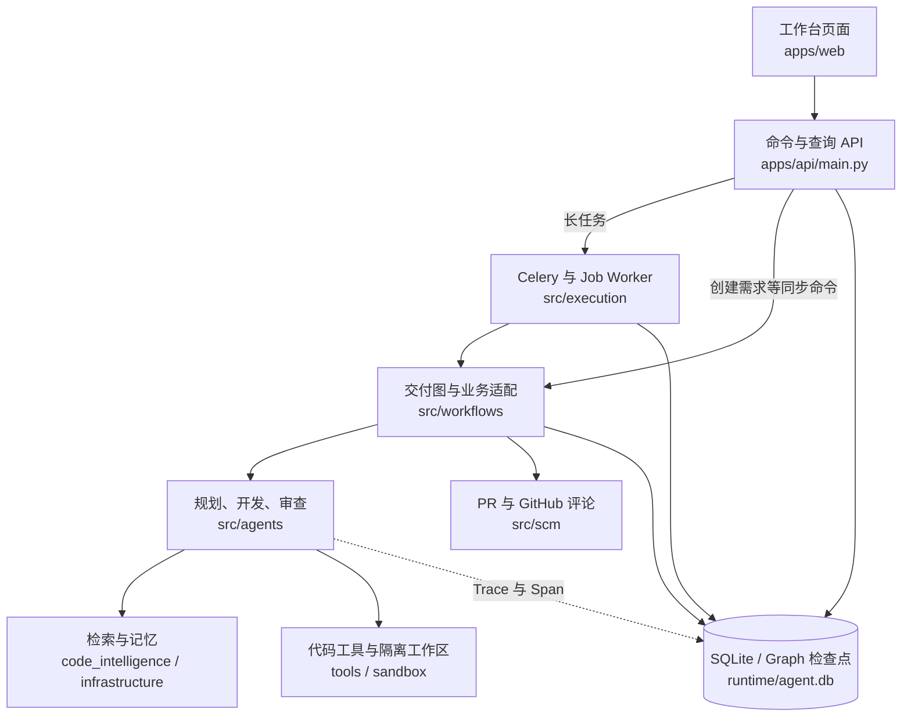

# DevRelay 功能与修改导航地图

_给准备亲手修改项目的开发者；2026-10-24 按当前工作区代码核对。部分实现已有未提交改动，本文是导航，不代表所有内容已提交或通过全量测试。_

---

## 📍 先看这里：从哪里开始改

不必先读完所有文件。先选一个页面或功能，沿着“按钮 → API → 方法 → 测试”向下找。

| 你想改什么 | 第一站 | 接下来找什么 |
| --- | --- | --- |
| 布局、字号、颜色 | [index.html](../apps/web/index.html)、[app.css](../apps/web/assets/app.css) | HTML 的 `id/class` 对应哪些渲染函数 |
| 页面展示的数据、按钮行为 | [app.js](../apps/web/assets/app.js) | `render()`、`setView()`、按钮的 `addEventListener()` |
| 需求分析或技术方案质量 | [requirement_planning_agent.py](../src/agents/requirement_planning_agent.py) | `plan()`、`_request_model_plan()`、只读规划工具 |
| Agent 查哪些文件、怎么查历史 | [repository_exploration_agent.py](../src/agents/repository_exploration_agent.py) | `explore()`、`RepositoryExplorationToolRegistry` |
| 代码怎么生成、失败怎么重试 | [code_development_agent.py](../src/agents/code_development_agent.py) | `run()`、`_request_proposal()`、`_run_attempt_graph()` |
| 检索、依赖扩展、Reranker | [indexer.py](../src/code_intelligence/indexer.py) | `rank_files()`、`rank_context_files()`、`rerank_candidates()` |
| 哪些问题阻止 CR 通过 | [code_review_agent.py](../src/agents/code_review_agent.py) | `review()`、`run_loop()`、阻塞级别和类别规则 |
| 页面刷新慢、重复请求、进度不更新 | [app.js](../apps/web/assets/app.js)、[main.py](../apps/api/main.py) | `initialize()`、`watchJob()`、列表/进度 GET 接口 |
| 暂停、恢复、心跳或流程状态 | [worker.py](../src/execution/worker.py)、[workflow_state.py](../src/workflows/workflow_state.py) | Job 生命周期与 Graph 状态分工，先看本文恢复部分 |

建议阅读顺序：一个按钮的事件处理 → 对应 API → 被调用的方法 → 同功能测试。不要从头逐行通读 `orchestrator.py`。

## 🗺️ 全局地图：运行时谁调用谁

这是职责地图，不是每个函数的精确调用图；创建需求和部分交付操作由 API 同步执行，批准开发、重审及继续对话等长任务经 Job 执行。



### 六个容易混淆的概念

| 名称 | 这里具体指什么 | 不要理解成 |
| --- | --- | --- |
| `Task` | 一个需求及其方案、结果、对话等业务投影 | 一次消息投递 |
| `ExecutionJob` | 一次批准开发、重审、继续对话或恢复的后台执行 | 一个完整需求只能有一个 Job |
| Celery Worker | 接收 Redis 消息并执行指定 Job 的进程 | 决定研发业务流程的状态机 |
| LangGraph | 顶层流程、子循环、状态投影和人工等待的组织方式 | 所有 Git、数据库操作都自动由框架实现 |
| Agent | 规划、探索、生成修改或审查的智能角色 | 每个角色都完全自主或并行执行 |
| Tool | 被代码包装的真实搜索、读取、修改或验证操作 | 只有工具描述，没有实际实现 |

外层流程以顺序与反馈循环为主。规划和仓库探索使用 `create_agent`；开发还包含结构化 Proposal 与工具执行，审查包含规则和模型判断，不能概括成三个完全相同的 `create_agent`。

## 🔧 功能地图：从页面走到后端

下表中的 API 均以 `/api` 开头；`{id}` 表示任务 ID，Job 接口单独标注。主 API 定义集中在 [main.py](../apps/api/main.py)。

### 页面与入口

| 功能/页面 | 前端定位 | API 与后端落点 |
| --- | --- | --- |
| 仓库注册、选文件夹或填 GitHub 链接 | `app.js` 的仓库表单、`browseRepositoryFolders()` | `POST /api/repositories`、`GET /api/repository-folders` → [RepositoryCatalog](../src/repository/catalog.py) 的 `register()` / `register_remote()` / `browse_directories()` |
| 历史任务列表、刷新恢复选择 | `refreshTaskList()`、`selectTask()`、`initialize()` | `GET /api/tasks` 取摘要，`GET /api/tasks/{id}` 取详情 → [SQLiteTaskStore](../src/infrastructure/store.py) |
| 新建需求、仓库事实、分析与技术方案 | 任务表单；`render()` 中的 `repository_analysis/technical_plan` | `POST /api/tasks` → `TaskOrchestrator.create_task()` → Graph 的分析、规划节点 |
| 修改方案、批准或拒绝 | `app.js` 中搜索 `/revise`、`/approve`、`/reject` | 方案修改走 `revise()`；批准走 `enqueue_approval()` 后台执行 |
| 开发页面实时进度和对话 | `renderDevelopmentProgress()`、`renderChatExecution()`、`watchJob()` | `/progress`、`/jobs`、`/events`、`/stream`；`POST /feedback` → `enqueue_user_feedback()` |
| 代码 Diff 与单栏/左右对比 | `loadCurrentDiffFiles()`、`renderMonacoDiff()`、`openDevelopmentDiff()` | `GET /api/tasks/{id}/diff-files` → `current_workspace_files()` → [WorkspaceManager.diff_files_from_baseline()](../src/sandbox/workspace.py) |
| 开发尝试、失败解释、相关文件和工具 | `render()` 的 attempts 部分；`analyzeAttemptFailure()`、`renderAttemptFiles()`、`renderAttemptToolCalls()` | 读取 Task 的 `development_attempts`；来源是开发执行记录，而不是重新调用模型解释所有日志 |
| CR 结果、重新审查、人工批准 | `renderReviewGate()`、`updateReviewStageBanner()`；搜索 `/review/run` | 重审走 `enqueue_review()` → `run_review()`；人工批准走 `approve_review()` |
| PR 发布、状态同步、合入 | `app.js` 中搜索 `publish-pr-button`、`refresh-pr-button`、`merge-pr-button` | `POST /pull-request/publish`、`/refresh`、`/merge` → [GitHubDeliveryService](../src/scm/publisher.py) |
| PR 评论驱动修改与回复 | 搜索 `sync-github-comments-button`、`process-github-comments-button` | 评论 sync/process → Worker 的 `github_comment_feedback` 分支；Beat 定时轮询 |
| Agent 可观测性、调用链和时间线 | `renderObservability()`、`showTrace()`、`renderTimeline()`、`correlateSpansToTimeline()` | `/traces`、`/api/traces/{trace_id}`、`/events`、`/api/metrics` → [tracing.py](../src/observability/tracing.py) |
| RAG 标注、测试集切换和评测 | [rag.js](../apps/web/assets/rag.js) 的 `loadRagDataset()`、`renderRagEditor()`、`renderRagReport()` | `/api/rag/dataset` 系列 → [RagDatasetService](../src/evaluation/dataset.py) |
| Figma 设计与 UI 验收 | `renderUIAcceptance()`、创建表单中的设计/预览地址 | `POST /ui-acceptance` → [UIAcceptanceService.validate()](../src/ui_validation.py)，Figma 获取由 `FigmaMCPClient.capture()` 负责；需外部服务和浏览器条件 |

### 一次需求的主要执行路径

| 阶段 | 从哪一段方法看起 | 会影响什么 |
| --- | --- | --- |
| 创建需求 | [TaskOrchestrator.create_task()](../src/workflows/orchestrator.py) → `delivery_graph.invoke()` | 创建 Task、分析仓库、生成需求分析和方案，等待审批 |
| 分析仓库 | `_graph_analyze_repository()` → [RepositoryAnalyzer.analyze()](../src/repository/analyzer.py) | 框架、HEAD、测试命令、代码证据和检索上下文 |
| 规划 | `_graph_plan()` / `_generate_requirement_plan()` → [RequirementPlanningAgent.plan()](../src/agents/requirement_planning_agent.py) | 影响文件、开发步骤、验证计划及风险 |
| 批准后开发 | API `approve_task()` → [enqueue_approval()](../src/execution/worker.py) → [Celery execute_job()](../src/execution/celery_app.py) → Worker `execute_job()` / `_execute_traced()` → Orchestrator `approve()` | 保存/领取 Job，执行业务命令；开发前核验基线，准备 Worktree |
| 实际开发 | `_graph_develop()` → `_run_real_development()` / `_execute_development_session()` → [CodeDevelopmentAgent.run()](../src/agents/code_development_agent.py) | 读取批准范围、探索、生成 Proposal、应用修改、测试及重试 |
| 生成 MR 草稿 | `_graph_generate_mr()` → `_write_merge_request()` → [MergeRequestBuilder.write()](../src/agents/merge_request_builder.py) | 修改说明、变更文件、测试摘要；不是已经发布远端 PR |
| 审查与修复 | `_graph_review()` → `_finish_review_pipeline()` / `_review_loop()` → [CodeReviewAgent.run_loop() / review()](../src/agents/code_review_agent.py) | Finding、阻塞结论，必要时调用开发修复，再次审查 |
| 发布和合入 | Orchestrator `publish_pull_request()` / `merge_pull_request()` → [publisher.py](../src/scm/publisher.py) | 真实 Git 提交、推送、创建或更新 PR、合入；有外部副作用 |

要改“下一步走哪个节点”，找 [orchestrator.py](../src/workflows/orchestrator.py) 的 `_build_delivery_graph()` 和路由方法；要改节点内部的业务动作，找同文件的 `_graph_*()` 方法和 Agent。状态持久化独立放在 [workflow_state.py](../src/workflows/workflow_state.py)。

## 🧠 智能能力地图：检索、历史、工具和模型

### 按能力查文件

| 想调整的能力 | 核心文件与方法 | 优先回归的测试 |
| --- | --- | --- |
| 检索关键词权重、别名、核心候选判断 | [indexer.py](../src/code_intelligence/indexer.py)：`rank_files()`、`_lexical_scores()`、`_primary_files()` | `test_real_rag.py`、`test_context_roles.py` |
| 调用方/依赖/测试扩展与规则重排 | 同上：`rank_context_files()` | `test_real_rag.py`、`test_repository_analysis.py` |
| Reranker 模型、候选预算、请求校验 | [reranker.py](../src/code_intelligence/reranker.py)：`RerankerClient.rank()`；Indexer 的 `rerank_candidates()` | `test_reranker.py` |
| 代码切片与向量库 | [vector_store.py](../src/code_intelligence/vector_store.py)：`code_chunks()`、`CodeVectorStore.search()`；[embedding.py](../src/code_intelligence/embedding.py) | `test_real_rag.py` |
| RAG 标注、评测与分组 | [dataset.py](../src/evaluation/dataset.py)：`import_history()`、`annotate()`、`evaluate()`；[retrieval.py](../src/evaluation/retrieval.py)：`evaluate_repository()`、`evaluate_rerankers()` | `test_rag_dataset.py`、`test_reranker.py` |
| 默认会话上下文与历史查询 | [task_context.py](../src/agents/task_context.py)：`refresh_task_summary()`、`build_task_context()`、`query_task_history()` | `test_task_context.py`、`test_context_management.py` |
| 执行记忆、失败日志和缓存 | [task_memory.py](../src/agents/task_memory.py)：`working_memory()`、`query_execution_memory()`；[working_memory_cache.py](../src/infrastructure/working_memory_cache.py) | `test_memory.py`、`test_memory_backends.py` |
| 跨任务的项目长期记忆 | [memory.py](../src/infrastructure/memory.py)、[semantic_memory.py](../src/infrastructure/semantic_memory.py)；更多说明见 [task-memory.md](task-memory.md) | `test_memory.py`、`test_memory_separation.py` |
| 自主探索提示词和工具调用次数 | [repository_exploration_agent.py](../src/agents/repository_exploration_agent.py)：`explore()`、`_explore_with_create_agent()` | `test_repository_exploration_agent.py` |
| 新增一个探索工具 | 同上：`RepositoryExplorationToolRegistry` 中的 `@tool`；实际操作写在 [developer_toolkit.py](../src/tools/developer_toolkit.py) 等所属模块 | `test_repository_exploration_agent.py`、`test_tool_policy.py` |
| 模型 Provider、结构化输出和 JSON 重试 | [gateway.py](../src/llm/gateway.py)：`build_model_gateway()`、`generate_structured()`、`_json_retry_messages()` | `test_model_gateway.py` |
| 上下文准入、预留输出、压缩 | [context_budget.py](../src/llm/context_budget.py)：`ContextBudget`、`fit_messages()`、`budget_middleware()` | `test_context_management.py`、`test_model_gateway.py` |
| 允许修改哪些文件、新组件申请 | [policy.py](../src/tools/policy.py)：`resolve_write_path()`；[component_scope.py](../src/tools/component_scope.py)：`approve_component_requests()` | `test_tool_policy.py`、`test_component_scope.py`、`test_new_file_delivery.py` |

测试名称均位于 [tests](../tests)。Reranker 的真实服务 A/B 结果与单元测试假评分要分开看，运行方式见 [README 的模型重排说明](../README.md)。

### 三种“查历史”不要改混

| 工具 | 查询对象 | 读取方式 |
| --- | --- | --- |
| `query_task_history` | 当前任务的用户反馈、Agent 回复、历史 Diff | 对已加载的 `user_feedback_rounds` 按轮次/关键词/文件过滤，两层分页 |
| `query_execution_memory` | 当前任务的开发尝试与测试输出 | 对开发尝试分页，长输出继续按偏移读取 |
| `query_project_memory` | 仓库级约定、架构观察、历史经验 | SQLite 原文与可选 Chroma 语义检索 |

查询工具注册在探索 Agent 的 Registry。查询结果进入工具消息并写入 `retrieved_history`，随后由 `build_task_context()` 交给生成修改方案的模型。要改“历史默认带多少”，改上下文构造或配置；要改“模型什么时候主动去查”，改探索提示词及工具描述。这是两个不同改动。

## ⚙️ 长任务地图：状态、暂停与恢复

| 关注点 | 去哪里改 | 必须保持的边界 |
| --- | --- | --- |
| 业务状态及数据结构 | [models.py](../src/domain/models.py) 中的 `TaskStatus`、`Task`、`ExecutionJob`、`TaskCheckpoint` | 新状态要同步 Graph 转移、API/页面标签及测试，不能只加一个枚举 |
| 状态转移、人工等待及持久化 | [workflow_state.py](../src/workflows/workflow_state.py)：`WorkflowStateStore.transition()` / `record_checkpoint()` | Task 是业务投影；交付图由 Orchestrator 构建，不要在别处新增一套互相独立的状态机 |
| 消息投递与队列 | [celery_app.py](../src/execution/celery_app.py)：`queue_for_action()`、`dispatch_execution_job()`、`execute_job()` | 队列区分职责，不代表同一需求的开发与审查可以无条件并行 |
| 领取 Job、心跳与执行分支 | [worker.py](../src/execution/worker.py)：`execute_job()`、`_execute_with_heartbeat()`、`_execute_traced()`；[store.py](../src/infrastructure/store.py) 的 Job/租约方法 | 心跳必须关联当前持有者；失联检测不是业务执行成功 |
| 暂停请求与继续执行 | Worker `cancel()` / `resume()` / `_pause_requested()`；Orchestrator `_checkpoint_handler()` / `resume_from_checkpoint()` | 是安全检查点处协作暂停，不是立刻杀掉正在执行的模型请求或测试 |
| 恢复诊断及一致性校验 | [recovery.py](../src/workflows/recovery.py)：`RecoveryCoordinator.diagnose()`；Orchestrator `_validate_checkpoint()` | 校验方案、基线、工作区与 Diff；不要为了“能恢复”直接跳过校验 |
| Worker 失联后接管 | Celery `recover_stale_jobs()` 与 Store 的租约回收 | Beat 扫描过期租约，不代替执行中的 Job 心跳 |

五类检查点为 `plan_approved`、`proposal_ready`、`patch_applied`、`test_result_saved`、`review_round_saved`。恢复相关修改优先跑 [test_recovery.py](../tests/test_recovery.py)、[test_execution_worker.py](../tests/test_execution_worker.py)、[test_task_graph.py](../tests/test_task_graph.py) 与 [test_workflow_graph.py](../tests/test_workflow_graph.py)。

## 💾 数据与服务地图：改了以后要重启什么

| 文件或服务 | 用途 | 修改注意事项 |
| --- | --- | --- |
| `apps/web/index.html`、JS、CSS | 页面结构、交互与样式 | 通常刷新即可；JS/CSS 有版本查询参数，修改后更新 HTML 的版本号 |
| API Python 进程，默认 `8765` | 页面服务、命令入口、查询 | 改 API 或其加载模块后重启 API；现有启动脚本不是自动热重载 |
| Celery Worker | 长任务执行 | 改 Agent、工具或执行逻辑后，空闲时重启 Worker；API 也用到的模块要一起重启 |
| Celery Beat | 定时租约扫描和 GitHub 评论轮询 | 改定时配置后重启 Beat；不要无意启动多个相同调度器 |
| Redis，默认 `6379` | Celery Broker/结果后端及可选工作记忆缓存 | 不保存代码 RAG 向量；不要用清库修复业务状态 |
| Chroma，默认 `8001` | 代码向量与长期记忆语义索引 | 改模型/维度需隔离向量空间；不要混用不兼容的旧向量 |
| `runtime/agent.db` | Task、Job、事件、Trace/Span、标注与检查点等 | 不手改状态、不删除“重新开始”；可用 SQLite GUI 只读排查 |
| `runtime/repositories` | GitHub 注册仓库的本地检出 | 不等于每个任务的开发工作区 |
| `runtime/tasks` | 各任务隔离 Worktree 等运行文件 | Diff 要与 Task 基线对比，不随意删除活跃工作区 |
| `runtime/indexes`、`runtime/vectors` | 文件索引缓存与 Chroma 数据 | 不提交 Git；清理前确认任务引用和可重建条件 |
| `.env` 与 [.env.example](../.env.example) | 本地密钥/配置与可提交配置模板 | 不在文档、源码或提交中写真实密钥；改配置后重启相关进程 |

启动脚本在 [scripts](../scripts)：`start-local.ps1`、`start-celery-worker.ps1`、`start-celery-beat.ps1`、`start-redis.ps1`、`start-chroma.ps1`、`start-ollama.ps1`。其中 Redis 使用 WSL Docker；API、Worker、Beat 当前本地脚本使用 Windows Python 进程，不是全套服务都在 Docker。

## 🧪 上手路线：先做小改动，再碰执行链路

### 练习一：给开发进度多展示一个已有字段

1. 在 `app.js` 找 `renderDevelopmentProgress()`，确认读取的是 `/progress` 的哪个字段。
2. 只改字段标签或展示位置，不修改 Job 状态判断。
3. 若新增 HTML 容器，同步改 `index.html` 与 CSS；更新静态资源版本号。
4. 跑 `node --check apps/web/assets/app.js` 与 `python -m pytest tests/test_api.py -q -k "not test_api_flow"`；页面验证执行中、失败、暂停三种显示。

### 练习二：调整 Agent 的历史回查行为

1. 在 `task_context.py` 检查默认摘要、最近轮次与预算，不先塞入全部历史。
2. 在探索 Registry 找 `query_task_history`，理解 `round_number/file/field/offset/text_offset`。
3. 提示词或工具逻辑改完，增加一个“旧约束只能通过回查找回”的测试。
4. 跑 `python -m pytest tests/test_task_context.py tests/test_memory.py tests/test_repository_exploration_agent.py -q`，确认查询结果会传到后续开发上下文。

### 练习三：试一个 RAG 排序改动

1. 固定数据集、仓库快照、Top K 和候选预算，先保存基线报告。
2. 只改 `rank_context_files()` 的一项规则，或 Reranker 的文档构造/候选预算，不同时换 Embedding。
3. 跑 `python -m pytest tests/test_real_rag.py tests/test_reranker.py -q`，再按 README 跑真实服务评测。
4. 对比逐条召回、候选池 Recall、最终 Top K 及耗时；不把测试集反复调参后的分数当独立泛化结果。

### 开始每次修改前

```powershell
git status --short
rg -n "你要找的按钮ID或方法名" apps src tests
```

当前已有其他未提交代码；不要用 `git add .` 把它们混进自己的提交。先做最小改动、增加对应回归用例，验证后只暂存本次文件，用中文提交信息记录。修改 Python 执行逻辑后，先确认没有运行任务再重启，避免打断开发。

## 🔍 按症状查问题

| 症状 | 第一检查位置 |
| --- | --- |
| 刷新后需求很久才出现 | 网络面板 `/api/tasks`、`initialize()`、`list_task_summaries()`；页面 GET 不应触发新的记忆检索 |
| 方案找错文件、核心候选太多 | `RepositoryAnalyzer.analyze()` → Indexer 的召回、扩展、重排和 `_primary_files()` → Plan 实际输出；检索候选不等于修改范围 |
| 模型说调用工具却看不到记录 | Registry `_execute()`、`ToolCallAudit`、Trace/Span、`renderChatExecution()`；先分清模型请求调用与工具实际成功 |
| 长期对话忘了旧要求 | `build_task_context()`、`query_task_history` 调用证据、`retrieved_history`；确认不是撤销轮次或摘要省略 |
| 任务停了但页面显示执行中 | Job 的 `heartbeat_at/lease_expires_at/worker_id`、Worker 日志及 Beat 的回收任务 |
| 重新审查仍看着旧代码 | `run_review()`、`_refresh_review_snapshot()`、当前工作区累计 Diff 及测试证据 |
| CR 因模型/上下文故障未完成 | Gateway、预算中间件、Review Finding；不要把平台故障当业务代码缺陷交给 Developer 修复 |
| Diff 与实际文件不一致 | `/diff-files`、`current_workspace_files()`、Task 基线 SHA、`diff_files_from_baseline()`；确认不是查看历史尝试的 Diff |
| PR 没有新增文件或推送失败 | `GitHubDeliveryService.publish()`、工作区 Git 状态、累计变更与远端分支；不要只看已有文件的修改 |

本文只提供定位入口，不宣称每项功能已在当前环境验证通过。运行与已知测试边界以 [README](../README.md) 和实际测试输出为准。
